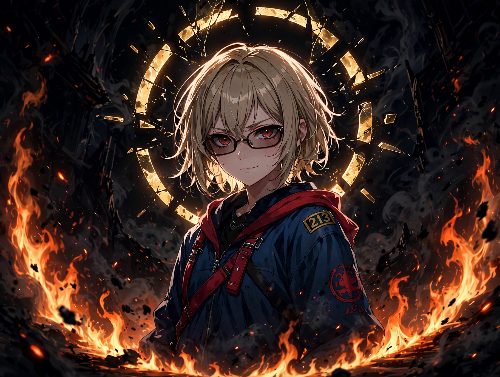
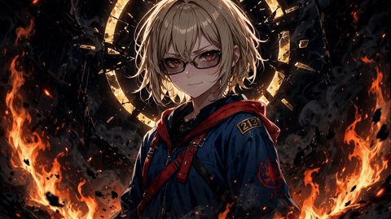

# imgtoavatar

**Turn a single illustration into a living 2D avatar.**

One still image goes in — a mesh-rigged avatar comes out: it blinks,
breathes, turns its head, sways its hair, and can talk along to a voice
track. No 3D model, no frame-by-frame drawing.

**Before — the still illustration**



**After — rigged and alive**



*Rayneshia, the example in this repo: a full scene illustration, split
into layers — background, ring, character, fire — each rigged with its
own motion and composited back into one living image.*

## How it works

The rigging is prepared by a coding agent following the skill in
[`skill/SKILL.md`](skill/SKILL.md), on top of the open-source
[mesh-avatar-studio](https://github.com/shinshin86/mesh-avatar-studio)
engine:

1. If the illustration is a full scene, the agent first splits it into
   layers (clean background plate, character, foreground effects). Then
   it drafts a mesh rig over the character (eyes, mouth, hair strands,
   body) and validates it.
2. Layers are built and a pose contact sheet is rendered — blink, mouth,
   head turns, hair sway — and visually reviewed.
3. You fine-tune proportions in the studio's local editor if you like.
4. The avatar is rendered: idle loops for lockscreens and wallpapers,
   talk renders for videos, or a packed avatar for the web.

## What's in this repo

| Path | What it is |
|---|---|
| `skill/SKILL.md` | The agent skill: workflow, quality gates, and hard lessons for rigging an illustration end to end |
| `examples/rayneshia/` | A complete worked example — source illustration, the layer split, the final rig, and the rendered loop |

## Quick start

```sh
# 1. Get the engine
git clone https://github.com/shinshin86/mesh-avatar-studio
cd mesh-avatar-studio && npm install   # Node.js 22.17+, Python 3.10+

# 2. Give your coding agent the skill from this repo (skill/SKILL.md)

# 3. Ask it: "rig this illustration" — and review the pose sheet it renders
```

## Example: Rayneshia

The character is an original illustration (from the music video *King Of
Curse*). The example folder holds the source image, the finished
`rig.json`, and the idle loop that runs as a live lockscreen — blinking,
breathing, hair swaying, embers drifting at the edges of the frame.

See [`examples/rayneshia/README.md`](examples/rayneshia/README.md) for the
breakdown.

## Credits

- Engine: [mesh-avatar-studio](https://github.com/shinshin86/mesh-avatar-studio)
  by Yuki Shindo (shinshin86), MIT License — this project would not exist
  without it.
- Character artwork in `examples/` © Tinandar Hermawan, shown as a worked
  example (see the example README for terms).

---

if ur interested and need key Api to access AI model you can check here : nandzstore.com

## License

The code and skill in this repository are released under the
[MIT License](LICENSE). The character artwork in `examples/` is **not**
covered by the MIT License.
