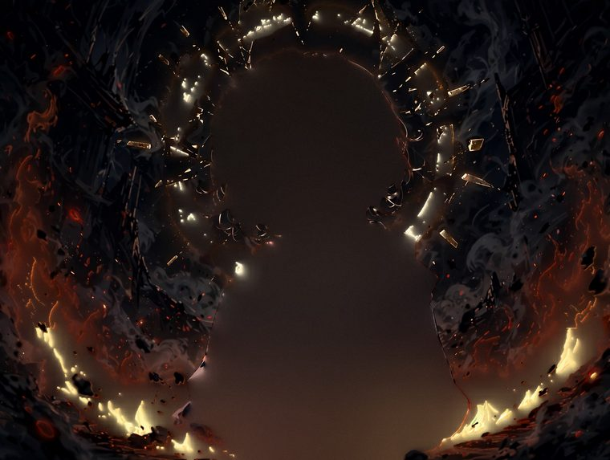
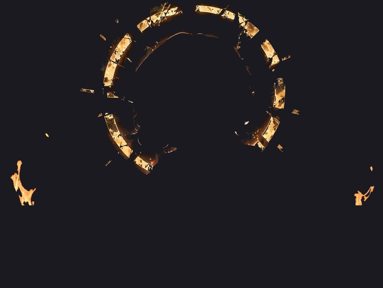
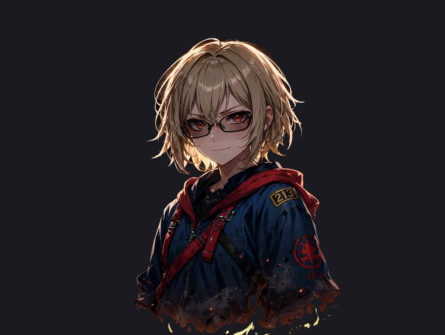
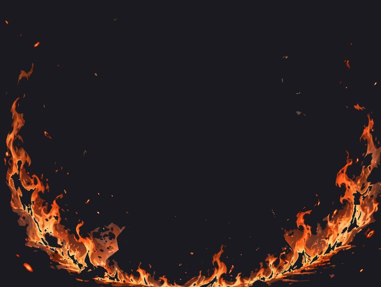

# Example: Rayneshia — the layered build

A complete worked example of the imgtoavatar workflow, using the harder
path: **a full scene illustration**, split into layers and rigged per
layer.

**Input:** one illustration — Rayneshia, an original character from the
music video *King Of Curse* (ash-blonde bob, red eyes, glasses, navy jacket
with a red-lined hood), painted *into* her scene: a golden ring behind
her, flames in front of and behind the body.

The starting point — the still illustration, exactly as drawn:

**Output:** the same image, alive — blinking, breathing, hair swaying,
flames breathing with her — rendered as a seamless 8-second loop.

## Why layers?

mesh-avatar-studio rigs a background-less character directly. This
illustration has a background, so it was decomposed first:

- **Fine split (11 working layers, back → front):** background → ring →
  flames-back → hair-back → body → face → hair-front → eyes → glasses →
  mouth → flames-front. The background is a clean plate — the character
  inpainted out — so nothing tears when the upper layers move.
- **Grouped into 4 plates for the final composite** (stack order,
  back → front):

**1. Background — the clean plate**

**2. Ring**

**3. Character**

**4. Fire — front + back flames**

- **Verified before animating:** re-stacking the plates reproduces the
  original with a diff of ≈ 0.2/255.
- **Rigged per layer, then composited:** the character carries the mesh
  animation (blink, breath, hair sway — strand `max` raised on the side
  strands and bangs); the ring and flames get their own subtle motion;
  procedural embers drift on top, kept off the face.

A 16:9 render of the same avatar also runs as a live lockscreen.

## Files

| File | What it is |
|---|---|
| `source.png` | The original illustration (the only input) |
| `rig.json` | The finished mesh rig produced from the validated draft |
| `avatar.json` | Avatar descriptor used by the studio runtime |
| `rayneshia-layered-loop.mp4` | The rendered layered loop (1824×1376, 8 s) |
| `preview.gif` | Short preview of the loop |
| `layers/` | The 4 composite plates (background / ring / character / fire), flattened for viewing |

## Terms

Artwork © Tinandar Hermawan. Published as a worked example — not covered
by this repository's MIT License; please don't redistribute or use the
character commercially without permission. The rig data in this folder was
produced with mesh-avatar-studio (MIT, by Yuki Shindo / shinshin86).
